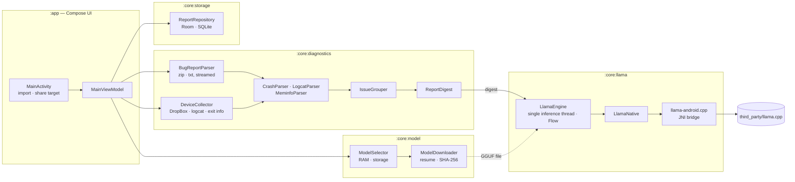

# BugAssistant

**On-device crash, memory and slowness triage for Android.**
BugAssistant analyzes Android **bug reports** and the phone's own logs. It finds crashes, ANRs, native crashes, memory pressure and causes of slowness, groups them into issues, saves each report in an on-device database, and uses an on-device LLM ([llama.cpp](https://github.com/ggml-org/llama.cpp) + Llama 3.2) to write a plain-English summary of what is wrong and what to do about it.
Diagnostics never leave the device unless you share them.

> **Status: v0.3, bug report import.** Bug report import, live scan, grouping, device health, saved history, sharing and the AI summary work. Not yet benchmarked or tested on real devices.

---

## Field workflow: "the app crashed" / "the device is slow"

Built for teams with internally distributed apps whose field staff report problems. No adb, root or special permission is needed.

1. On the problem device: **Settings › Developer options › Take bug report** (Interactive or Full). Android collects logs for a minute or two and shows a notification.
2. Tap the notification and **Share** it to **BugAssistant** (or save the `.zip` and use **Import bug report** in the app).
3. BugAssistant reads the zip on the device, shows crashes, ANRs, native crashes, low-memory kills and **memory-leak suspects** (OutOfMemoryError, Java heap at or near its limit, many Activities kept in memory) for **every app**, plus a **Device health** card (CPU load and busiest processes, thermal throttling, free storage, largest memory users, UI jank), then writes the AI summary.
4. The report and its summary are saved in the app's database (**Saved reports**). Use **Share** to send a plain-text report to the developers.
5. Use **App: All apps ▾** to focus on your own package (for example `com.acme.field`). The issue list, AI summary, saved-report counts and shared text then cover only that app, plus device-wide low-memory events. The choice is remembered, so field devices stay focused on your app.

The bug report can also be analyzed on a different phone: share the zip from the field device to a team lead's phone that has BugAssistant installed.

### Querying the database by app

Every issue row stores its `packageName` (the process name without a `:suffix`). The `app_issues` view joins issues with their report for direct SQL, for example in Android Studio **App Inspection › Database Inspector** (debuggable builds) or on a copy of `reports.db`:

```sql
SELECT device, collectedAt, kind, type, message, count
FROM app_issues
WHERE packageName = 'com.acme.field'
ORDER BY collectedAt DESC;
```

The database is app-private. To get the data off the phone, tap **Export CSV** (next to **Saved reports**) and pick a folder such as Downloads. The CSV holds every saved issue, only for the selected app when the app filter is set: report id, source, file, device, capture time, package, process, kind, count, first/last seen (ISO-8601 UTC), exception type, message, cause and stack frames. It opens in Excel or Google Sheets; cells that look like formulas are prefixed with `'`. No storage permission is needed, because the system file picker grants access to just that file.

---

## How it works

> **Deterministic code finds the facts; the model explains them.**

1. **Collect:** Kotlin code reads an imported bug report (streamed, never fully loaded into memory) or the phone's own logs (see [Data sources](#data-sources)), plus memory and device-health data.
2. **Group:** parsers turn raw stack traces and log lines into issues, deduplicated by a signature (kind, process, root-cause type and first app frame).
3. **Save:** the report is stored in a Room (SQLite) database; identical re-imports and repeat scans reuse the saved record and its summary.
4. **Digest:** the top issues, memory and health numbers are packed into a short text digest (≤ 6,000 characters).
5. **Summarize:** the on-device model reads the digest and writes the triage: likely causes, suggested fixes, a memory assessment and, for bug reports, likely causes of slowness. The summary is saved with the report.

The model never scans raw logs. Small models are weak at searching 50k lines of noise but reasonable at explaining a short, clean summary.

> **Note:** "DropBox" below means Android's built-in [`DropBoxManager`](https://developer.android.com/reference/android/os/DropBoxManager) log store, **not** the Dropbox cloud service. Nothing is uploaded anywhere.

## Data sources

The app uses the best access level it has and falls back gracefully.

| Access | How to get it | What is collected |
|---|---|---|
| **Bug report** (recommended) | Import or share a bug report zip; no permission needed | Every app: system/event/crash logs, DropBox entries, tombstones, ANR traces, `am_crash`/`am_anr`/`am_low_memory` events, ART heap/OOM log lines, plus meminfo (including per-app heap and Activity counts), cpuinfo, diskstats, thermal status and frame jank |
| **Full** | `READ_LOGS` + Usage access | System-wide DropBox entries (`*_crash`, `*_native_crash`, `SYSTEM_TOMBSTONE`, `*_anr`, `system_server_watchdog`, `*_lowmem`) and low-memory-killer events |
| **Logs only** | `READ_LOGS` | System-wide logcat crash buffer, `am_anr` events, low-memory-killer events |
| **Own app** | Nothing (default) | This app's own exit reasons (`ApplicationExitInfo`, API 30+) |

Live scans (**Scan this device**) use the best of the last three levels. `READ_LOGS` can only be granted with adb:

```bash
adb shell pm grant com.reaj.bugassistant android.permission.READ_LOGS
adb shell appops set com.reaj.bugassistant GET_USAGE_STATS allow   # or Settings > Usage access
```

Restart the app after granting. Live scans also include a memory snapshot (total/available RAM, low-memory threshold and flag, swap usage).

## Model selection

On first launch the app picks a model based on the phone's resources:

| Device | Model | Download |
|---|---|---|
| ≥ ~6 GB RAM and enough free storage | **Llama 3.2 3B Instruct** (Q4_K_M) | ~2.0 GB |
| Less RAM, a low-RAM device, or not enough storage for 3B | **Llama 3.2 1B Instruct** (Q4_K_M) | ~808 MB |
| Not enough storage even for 1B | No download; the app shows how much space to free | — |

The screen shows which model is in use and why. Downloads resume after interruptions, are checked against a SHA-256 hash, and only the chosen model is kept on disk.

## Architecture



| Module | Responsibility |
|---|---|
| [`app`](app) | Compose UI: import, overview, device health, AI summary, issue list, saved reports and sharing. It knows nothing about JNI, SQL or HTTP. |
| [`core/diagnostics`](core/diagnostics) | Parses bug reports and collects live crash data per access level; parses Java/native crashes, ANRs, LMK events and device health; groups issues; builds the LLM digest and share text. Parsers are pure Kotlin and unit-tested. |
| [`core/storage`](core/storage) | Room database of saved reports (`reports`, `issue_groups`, `process_stats`, `summaries`, `app_issues` view), with fingerprint-based de-duplication. |
| [`core/model`](core/model) | `ModelSpec`, `ModelSelector` (RAM/storage-based choice), and `ModelDownloader` (resumable, verified, atomic). |
| [`core/llama`](core/llama) | C++ JNI bridge, Kotlin binding and `LlamaEngine`, which serializes native access onto one thread and streams output as a cancellable `Flow`. |
| [`third_party/llama.cpp`](third_party) | Git submodule pinned to a known-good commit. |
| [`samples/crashlab`](samples/crashlab) | Test-only app that crashes, hangs and leaks memory on purpose, for end-to-end testing. Never ship it. |

Deeper notes (threading, memory, JNI contract, grouping rules) are in [docs/ARCHITECTURE.md](docs/ARCHITECTURE.md).

## Engineering decisions

| Decision | Why |
|---|---|
| **Parsers find facts, the LLM only explains** | Grouping and counts are exact and testable; the model gets a short digest it can actually reason over. |
| **Bug report import as the main path** | Covers every app with no adb or root, which suits field devices; the live scan remains for adb-provisioned devices. |
| **Streaming bug report parser** | Bug reports are 10–100 MB; sections are read line by line with caps, so low-end phones do not run out of memory. |
| **Normalized Room tables, not JSON blobs** | Reports can be listed and queried by counts, device and date without parsing. |
| **Tiered access with fallback** | System-wide data needs adb-granted permissions, but the app is still useful with none. |
| **Model chosen by RAM and storage** | 3B gives better summaries but needs ~6 GB RAM; low-end devices get 1B instead of crashing or failing to download. |
| **UTF-8 `byte[]` across JNI, not `jstring`** | `NewStringUTF` uses *modified* UTF-8 and corrupts 4-byte code points; tokens can also end mid-character. |
| **One dedicated inference thread** | A `llama_context` is not thread-safe; a single-thread dispatcher removes races without C++ locks. |
| **Atomic cancel flag tied to Flow cancellation** | Stop or leaving the screen ends generation within one token. |
| **Native code always built `Release`** | Debug ggml is more than 10× slower. |
| **Model downloaded at runtime, verified, then renamed** | Keeps the APK small; a partial or tampered file is never loaded. |

## Getting started

**Requirements:** Android Studio (AGP 9), Android SDK 36, NDK and CMake 3.22.1, and a physical **arm64** device (Android 9+, 4 GB RAM or more).

```bash
git clone --recursive https://github.com/<you>/BugAssistant.git
cd BugAssistant
./gradlew :app:installDebug
```

To skip the download during development, push the model yourself (use the file the app chose):

```bash
adb push Llama-3.2-3B-Instruct-Q4_K_M.gguf /sdcard/Android/data/com.reaj.bugassistant/files/
```

Native logs from llama.cpp go to logcat under the tag `LlamaJNI`.

### Tests

```bash
./gradlew :core:model:testDebugUnitTest :core:diagnostics:testDebugUnitTest :core:storage:testDebugUnitTest
```

For an on-device check, install the Crash Lab test app (`./gradlew :samples:crashlab:installDebug`), trigger crashes, an ANR and memory leaks, then import a bug report. The test cases and expected results are in [docs/TESTING.md](docs/TESTING.md).

## Privacy

- Bug reports, crash logs, memory data and summaries stay on the device; there is no upload or analytics. The imported zip itself is not copied; only the parsed results are saved in the app's private database, which is excluded from Android cloud backup.
- **Share** sends a plain-text report only when you choose a destination.
- The only network access is the one-time model download from Hugging Face.
- Bug reports and system-wide logs can contain personal data from other apps (account names, locations, messages in logs). Treat them as sensitive, and delete saved reports you no longer need.

## Benchmarks

Measured on-device with the built-in load time and tokens-per-second counters. *To be filled in.*

| Device | SoC | Model | Threads | Load (ms) | Decode (tok/s) | Peak RSS |
|---|---|---|---|---|---|---|
| — | — | Llama 3.2 3B Q4_K_M | 4 | — | — | — |
| — | — | Llama 3.2 1B Q4_K_M | 4 | — | — | — |

## Roadmap

- [x] **v0.1, inference foundation:** llama.cpp via NDK, JNI bridge, streaming, cancellation, verified resumable download
- [x] **v0.2, device triage:** crash/ANR/native/LMK collection, grouping, memory snapshot, AI summary, RAM/storage-based model choice
- [x] **v0.3, bug report import:** zip/txt import and share target, device health (CPU, thermal, storage, memory, jank), Room history, share as text
- [ ] Structured output (GBNF JSON schema) with cited frames checked against the input
- [ ] Deeper ANR analysis: lock graphs, binder and main-thread classification
- [x] Filter by app package (UI, per-app summaries, `app_issues` SQL view)
- [x] CSV export of saved issues to a user-chosen folder
- [ ] Backend sync and trends across saved reports
- [ ] Background download via WorkManager; GPU backends (Vulkan / OpenCL)

## Acknowledgements

Built on [llama.cpp](https://github.com/ggml-org/llama.cpp) (MIT).

**Built with Llama.** The app downloads [Llama 3.2 3B Instruct](https://huggingface.co/meta-llama/Llama-3.2-3B-Instruct) or [Llama 3.2 1B Instruct](https://huggingface.co/meta-llama/Llama-3.2-1B-Instruct) at runtime (GGUF quantizations by [bartowski](https://huggingface.co/bartowski)).
Llama 3.2 is licensed under the [Llama 3.2 Community License](https://github.com/meta-llama/llama-models/blob/main/models/llama3_2/LICENSE), Copyright © Meta Platforms, Inc. All Rights Reserved, and its use is subject to the [Acceptable Use Policy](https://github.com/meta-llama/llama-models/blob/main/models/llama3_2/USE_POLICY.md).
Model weights are not included in this repository.

## License

BugAssistant's source code is licensed under the [Apache License, Version 2.0](LICENSE). Copyright 2026 Reaj.

Third-party notices are in [NOTICE](NOTICE). The Llama 3.2 models are **not** covered by the Apache license; see above.
